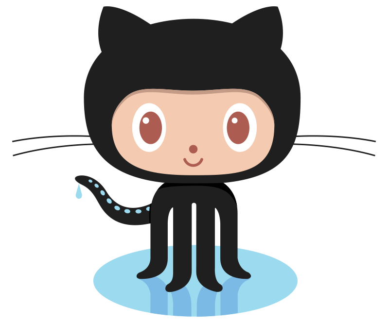

### Hello World 

<table style="border-collapse: collapse; margin: auto;">
  <tr style="border: none;">
    <td style="border: none; font-size: 20px; text-align: center;">I'm active on</td>
    <td style="border: none; text-align: center;">
      <a href="https://gitlab.com/ahmadabuhasan">
        
      </a>
    </td>
  </tr>
</table>

#### I'm Ahmad Abu Hasan, a passionate self-taught programmer from Indonesia


[](https://skillicons.dev)

[](https://connect-with-eby.web.app)
[](https://github.com/eby-dev/eby-dev/actions/workflows/anmol098.yml)
[](https://wakatime.com/@bbcd646f-1daf-4865-a20e-46d4c803e6f8)



### Spotify Playing 🎧

[](https://open.spotify.com/user/gr3y7pr12w9ol2dy2ccdb10e7)

##### MOTTO

```
while ( ! (succeed = try( ) ) );

“Everybody should learn to program a computer,

because it teaches you how to think.” - Steve Jobs
```

<details open>
  <summary> :clock3: <b>Time spent in IDE for this repository, automatically tracked with WakaTime.</b> </summary>
<br />

| Project | Time |
| -- | -- |
| A | B |
| C | D |

</details>

<details open>
  <summary> :zap: <b>Development Stats</b> </summary>
<br/>

<!--START_SECTION:waka-->


📊 **This Week I Spent My Time On** 

```text
💬 Programming Languages: 
Other                    18 hrs 13 mins      ████████████████████░░░░░   78.13 % 
Markdown                 3 hrs               ███░░░░░░░░░░░░░░░░░░░░░░   12.90 % 
PowerShell               25 mins             ░░░░░░░░░░░░░░░░░░░░░░░░░   01.80 % 
Python                   21 mins             ░░░░░░░░░░░░░░░░░░░░░░░░░   01.57 % 
PHP                      18 mins             ░░░░░░░░░░░░░░░░░░░░░░░░░   01.32 % 

🐱‍💻 Projects: 
v3                       13 hrs 58 mins      ███████████████░░░░░░░░░░   59.91 % 
cat                      4 hrs 47 mins       █████░░░░░░░░░░░░░░░░░░░░   20.57 % 
noche-brighton           1 hr 48 mins        ██░░░░░░░░░░░░░░░░░░░░░░░   07.79 % 
ahmadabuhasan            1 hr 16 mins        █░░░░░░░░░░░░░░░░░░░░░░░░   05.44 % 
flutter                  59 mins             █░░░░░░░░░░░░░░░░░░░░░░░░   04.27 % 
```

🤖 **AI Coding This Week** 

```text
⏱ AI Coding Time: 6 hrs 13 mins (26.69%)

✍️ 2,107 lines written by AI, 765 lines written by hand (73.36% AI-written)

🔤 1,267,573 Input Tokens, 300,388 Output Tokens

💵 $1.24 Estimated AI Cost This Week

🧠 9 AI Sessions, 193 AI Prompts

GPT                      2,142 lines         █████████████████████████   100.00 % 
Opus                     0 lines             ░░░░░░░░░░░░░░░░░░░░░░░░░   00.00 % 

🔎 AI Coding Insights:
🤖 AI-Driven — 73.36% of written lines came from AI
📝 Concise Prompter — average 156 characters per prompt
🔁 Iterative Prompter — average 21 prompts per session
🚀 High AI Trust — 41.62% of changed lines were hand-edited
```


 Last Updated on 03/11/2026 22:35:44 UTC
<!--END_SECTION:waka-->

#### Watch my contribution graph get eaten by the snake 🐍

<picture>
  <source media="(prefers-color-scheme: dark)" srcset="https://raw.githubusercontent.com/eby-dev/eby-dev/output/github-contribution-grid-snake-dark.svg" />
  <source media="(prefers-color-scheme: light)" srcset="https://raw.githubusercontent.com/eby-dev/eby-dev/output/github-contribution-grid-snake.svg" />
  
</picture>

</details>

<!--
<details>
  <summary> :zap: <b>Github Stats</b> </summary>
<p align="center">:heart:</p>
<p align="center"><a href="https://github.com/eby-dev">
  
  
</a></p>
<p align="center">
  <a href="https://github.com/eby-dev">
    
  </a>
</p>
</details>
-->

<!--
<details>
  <summary> :zap: <b>Github Badges</b> </summary>
  <br>
  <a href='https://archiveprogram.github.com/'></a> 
  <a href='https://docs.github.com/en/developers'></a> 
  <a href='https://github.com/pricing'></a> 
  <a href='https://stars.github.com/'></a> 
  <a href='https://docs.github.com/en/github/supporting-the-open-source-community-with-github-sponsors'></a>
</details>
-->

---
